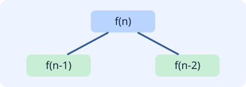

# Profile: Pratham Shah

- **NetID:** pnshah
- **Major:** Data Science
- **Question that I chose from the memoization exercise:** Count ways to reach the n'th stair
- **Link to the question article:** <https://www.geeksforgeeks.org/dsa/count-ways-reach-nth-stair/>
- **My solution:**

```c
#include <stdio.h>
#include <stdlib.h>

static int count_ways(int n, int memo[])
{
    if (n == 0 || n == 1) {
        return 1;
    }

    if (memo[n] != -1) {
        return memo[n];
    }

    memo[n] = count_ways(n - 1, memo) + count_ways(n - 2, memo);
    return memo[n];
}

int main(void)
{
    int n;
    int *memo;
    int result;

    if (scanf("%d", &n) != 1 || n < 0) {
        return 1;
    }

    memo = malloc((size_t)(n + 1) * sizeof(*memo));
    if (memo == NULL) {
        return 1;
    }

    for (int i = 0; i <= n; i++) {
        memo[i] = -1;
    }

    result = count_ways(n, memo);
    free(memo);
    printf("%d\n", result);
    return 0;
}
```

## Test results

| n | expected | actual |
|---:|---:|---:|
| 0 | 1 | 1 |
| 1 | 1 | 1 |
| 2 | 2 | 2 |
| 5 | 8 | 8 |
| 10 | 89 | 89 |
| 30 | 1346269 | 1346269 |

## Memoization diagram



## Compile and run

```sh
gcc -Wall -Wextra -std=c11 stair.c -o stair
printf '10\n' | ./stair
```
